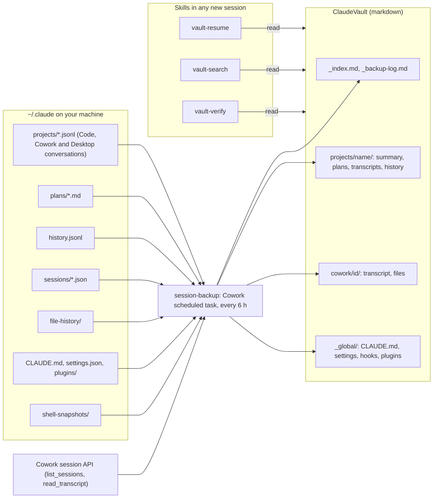

<p align="center"></p>

<p align="center">
  <a href="LICENSE"></a>
  
  
  
  <a href="https://github.com/abhinav-adtechs/Claude-Backup/actions/workflows/ci.yml"></a>
  <a href="https://github.com/abhinav-adtechs/Claude-Backup/commits/main"></a>
  <a href="https://github.com/abhinav-adtechs/Claude-Backup/stargazers"></a>
</p>

<p align="center"><b>Never lose your Claude context again. Every session, plan and prompt backed up to a local markdown vault, and any new session — on any account — picks up where you left off.</b></p>

<p align="center">
  <a href="#features">Features</a> ·
  <a href="#quick-start">Quick start</a> ·
  <a href="#architecture">Architecture</a> ·
  <a href="#docs">Docs</a> ·
  <a href="#roadmap">Roadmap</a> ·
  <a href="#contributing">Contributing</a>
</p>

## Why Claude-Backup?

Claude accounts log you out. Sessions expire. Context disappears. You're left scrambling to remember what you were
working on, which decisions were made, and where you left off.

Claude-Backup is two things:

1. **A scheduled backup** that runs every 6 hours as a Cowork task, archiving your Claude Code sessions, Cowork
   transcripts, implementation plans, prompt history, file edits and config into a structured local vault
   (`~/Documents/ClaudeVault/` by default).
2. **A resume skill**, `vault-resume`, that any new Claude session can use to read the vault and pick up exactly where
   you left off, regardless of which account you're on.

Restoring here means restoring **context**: nothing is written back into `~/.claude`. A fresh session reads the vault
and carries on.

## Features

<table>
<tr>
<td width="50%" valign="top">

### 🗄️ Everything, organised by project

- Full conversation transcripts from `~/.claude/projects/`, converted from JSONL to readable markdown
- Plans, prompt history, session metadata and file edit history, grouped by the project they belong to
- Cowork transcripts and output files, plus your `CLAUDE.md`, settings, hooks and plugins

</td>
<td width="50%" valign="top">

### ⏯️ Resume from any account

- Say _"pick up where I left off"_ or _"resume my-web-app"_ in a new session
- Loads only the project you name (or the one matching your working directory), not the whole vault
- Warns you when the last successful backup is more than 24 hours old

</td>
</tr>
<tr>
<td valign="top">

### 🏷️ Plans you can actually find

- Random plan names like `binary-singing-lake.md` are renamed from the plan's own heading
- A `plans/_index.md` per project: topic and a one-line summary for every plan
- _"list plans"_, _"show me plans for X"_ and _"resume [plan name]"_ just work

</td>
<td valign="top">

### 🔁 Incremental and safe to re-run

- Skips files whose modification time hasn't changed (`.timestamps.json`)
- Marks each run `IN PROGRESS` first, so a backup that died halfway is visible
- Never deletes or overwrites with less data; failures are logged and the run continues

</td>
</tr>
<tr>
<td valign="top">

### 🔍 Search and health checks

- `vault-search`: find past decisions, code and prompts across every project at once
- `vault-verify`: last backup time, missing files, stale-vault warnings at 12, 24 and 72 hours

</td>
<td valign="top">

### 🔒 Private by default

- The vault is plain markdown on your own disk; the installers only copy files, and nothing syncs unless you set it up
- A `.gitignore` in the vault keeps transcripts, file history and shell snapshots out of any repo you sync it to
- One-line installers for macOS, Windows and Linux, with `--check` and `--uninstall`

</td>
</tr>
</table>

## Tech stack


There is no backup binary: the backup is a Cowork scheduled task whose instructions live in
[`scheduled-task/SKILL.md`](scheduled-task/SKILL.md), and Claude carries them out. The installers only put the task
and the resume skill in place, with your vault path filled in.

## Architecture



`history.jsonl` is the ground truth for which project each conversation belongs to: every entry carries the project's
real absolute path, so the task builds a path map before decoding the encoded directory names under
`~/.claude/projects/`. See [docs/ARCHITECTURE.md](docs/ARCHITECTURE.md) for the full backup pipeline, the vault format
and how the skills read it.

## Quick start

**You need:** Claude Desktop with Cowork, and `git`. For Claude Code session backups, Claude Code. Pick your OS:

<details open>
<summary><b>🍎 macOS</b></summary>

<br>

```bash
git clone https://github.com/abhinav-adtechs/Claude-Backup.git
cd Claude-Backup
chmod +x install.sh
./install.sh                          # vault in ~/Documents/ClaudeVault
./install.sh ~/Dropbox/ClaudeVault    # …or anywhere you like
```

| What           | Installed to                                           |
| -------------- | ------------------------------------------------------ |
| Resume skill   | `~/.claude/vault-resume/SKILL.md`                      |
| Scheduled task | `~/Documents/Claude/Scheduled/session-backup/SKILL.md` |
| Default vault  | `~/Documents/ClaudeVault/` (gets a `.gitignore`)       |

```bash
./install.sh --check        # verify the installation
./install.sh --uninstall    # remove the skill and the task; the vault is kept
```

</details>

<details>
<summary><b>🪟 Windows</b></summary>

<br>

Run it from PowerShell 7 (`pwsh`) or from Windows PowerShell 5.1, which is built into Windows 10 and 11.

```powershell
git clone https://github.com/abhinav-adtechs/Claude-Backup.git
cd Claude-Backup
.\install.ps1                                                    # vault in Documents\ClaudeVault
.\install.ps1 -VaultPath "C:\Users\you\Dropbox\ClaudeVault"      # …or anywhere you like
```

| What           | Installed to                                                       |
| -------------- | ------------------------------------------------------------------ |
| Resume skill   | `%USERPROFILE%\.claude\vault-resume\SKILL.md`                      |
| Scheduled task | `%USERPROFILE%\Documents\Claude\Scheduled\session-backup\SKILL.md` |
| Default vault  | `%USERPROFILE%\Documents\ClaudeVault\` (gets a `.gitignore`)       |

```powershell
.\install.ps1 -Check        # verify the installation
.\install.ps1 -Uninstall    # remove the skill and the task; the vault is kept
```

> [!TIP]
> If PowerShell says running scripts is disabled on this system, allow it for the current window only, then run the
> installer again:
>
> ```powershell
> Set-ExecutionPolicy -Scope Process -ExecutionPolicy Bypass
> ```

> [!NOTE]
> `install.ps1` is ASCII-only, so Windows PowerShell 5.1 parses it whatever the system code page. The installer
> writes the vault path with forward slashes inside the skills (`C:/Users/you/...`), which is expected.

</details>

<details>
<summary><b>🐧 Linux</b></summary>

<br>

```bash
git clone https://github.com/abhinav-adtechs/Claude-Backup.git
cd Claude-Backup
chmod +x install.sh
./install.sh                    # vault in ~/.local/share/ClaudeVault
./install.sh /path/to/vault     # …or anywhere you like
```

| What           | Installed to                                              |
| -------------- | --------------------------------------------------------- |
| Resume skill   | `~/.claude/vault-resume/SKILL.md`                         |
| Scheduled task | `~/.local/share/claude/Scheduled/session-backup/SKILL.md` |
| Default vault  | `~/.local/share/ClaudeVault/` (gets a `.gitignore`)       |

`./install.sh --check` and `./install.sh --uninstall` work the same as on macOS.

</details>

> [!NOTE]
> You can run the installer from any directory: it finds `skill/`, `scheduled-task/` and
> `vault-gitignore.template` relative to the installer itself, not the current directory.

### Run the first backup

1. Open Claude Desktop in **Cowork** mode.
2. Go to **Scheduled** in the sidebar.
3. Click **Run now** on `session-backup`, and allow access to `~/.claude` and `~/Documents` when asked.

That's it. Your first backup populates the vault; after that the task is meant to run every 6 hours.

### Make the resume skill available

The installer writes `vault-resume`, with your vault path filled in, to `~/.claude/vault-resume/SKILL.md`. Add that
folder to Claude the way you add any custom skill:

- **Claude Code:** copy it into your personal skills folder.

  ```bash
  mkdir -p ~/.claude/skills && cp -R ~/.claude/vault-resume ~/.claude/skills/
  ```

  ```powershell
  New-Item -ItemType Directory -Force "$env:USERPROFILE\.claude\skills" | Out-Null
  Copy-Item -Recurse "$env:USERPROFILE\.claude\vault-resume" "$env:USERPROFILE\.claude\skills\"
  ```

- **Claude Desktop:** zip the `vault-resume` folder and upload it as a custom skill in Claude's settings.

## Resume a project

In any new Claude session (Code, Cowork or Chat), just say:

- _"Pick up where I left off"_
- _"What was I working on?"_
- _"Resume [project name]"_
- _"What's the status of my projects?"_

`vault-resume` reads your vault and gives you the context back: the last prompts you sent, architectural decisions,
current bugs and suggested next steps. Name a project and only that project is loaded; ask generally and you get a
summary across all projects from `_index.md`. It also follows the conventions in your backed-up `_global/CLAUDE.md`.

### Optional skills

| Skill                                   | Ask it                                                                          | What it does                                                                           |
| --------------------------------------- | ------------------------------------------------------------------------------- | -------------------------------------------------------------------------------------- |
| [`vault-search`](skill-search/SKILL.md) | _"search my vault for X"_, _"find where I decided X"_, _"did I ever work on Y"_ | Searches plans, summaries, history, then transcripts; groups hits by project           |
| [`vault-verify`](skill-verify/SKILL.md) | _"check my vault"_, _"verify backup"_, _"is my backup up to date"_              | Reports the last backup time, missing files and incomplete projects as a health report |

The installers don't install these two. Add the `skill-search` and `skill-verify` folders the same way as the resume
skill. They read the default vault path, so if you installed to a custom location, replace `~/Documents/ClaudeVault/`
in their `SKILL.md` first.

## What gets backed up

| Data                          | Source                              | Location in the vault           |
| ----------------------------- | ----------------------------------- | ------------------------------- |
| Full conversation transcripts | `~/.claude/projects/`               | `projects/<name>/transcripts/`  |
| Implementation plans          | `~/.claude/plans/`                  | `projects/<name>/plans/`        |
| Prompt history                | `~/.claude/history.jsonl`           | `projects/<name>/history.md`    |
| Session metadata              | `~/.claude/sessions/`               | `projects/<name>/sessions/`     |
| File edit history             | `~/.claude/file-history/`           | `projects/<name>/file-history/` |
| Global config                 | `~/.claude/CLAUDE.md`               | `_global/CLAUDE.md`             |
| Settings and hooks            | `~/.claude/settings.json`           | `_global/settings-snapshot.md`  |
| Installed plugins             | `~/.claude/plugins/`                | `_global/plugins.md`            |
| Cowork transcripts            | `~/.claude/projects/` + session API | `cowork/<id>/transcript.md`     |
| Cowork output files           | Cowork working dirs                 | `cowork/<id>/files/`            |
| Shell environment             | `~/.claude/shell-snapshots/`        | `shell-snapshots/`              |

Everything is organised **by project**, with generated summaries and a master index.

<details>
<summary><b>Vault structure</b></summary>

<br>

```text
~/Documents/ClaudeVault/
├── _index.md              # Master index with Quick Resume per project
├── _backup-log.md         # When backups ran
├── _global/               # Your Claude config, hooks, plugins
├── projects/
│   ├── my-web-app/
│   │   ├── _project-summary.md   # Overview + Quick Resume
│   │   ├── plans/                # Implementation plans (renamed to descriptive titles)
│   │   │   ├── _index.md         # Table of all plans with topics and summaries
│   │   │   └── *.md              # Individual plan files
│   │   ├── transcripts/          # Full conversation transcripts
│   │   ├── sessions/             # Session metadata
│   │   ├── history.md            # Every prompt you sent
│   │   └── file-history/         # Files Claude edited
│   └── _unmatched/               # Plans not tied to a project
├── cowork/
│   ├── _cowork-index.md
│   └── <session-id>/
│       ├── transcript.md
│       └── files/
└── shell-snapshots/              # Terminal environment
```

</details>

## Configuration

There are no environment variables or config files: the installers take everything as arguments.

| Option                  | macOS / Linux                 | Windows                            |
| ----------------------- | ----------------------------- | ---------------------------------- |
| Install, default vault  | `./install.sh`                | `.\install.ps1`                    |
| Install, custom vault   | `./install.sh /path/to/vault` | `.\install.ps1 -VaultPath C:\path` |
| Check the installation  | `./install.sh --check`        | `.\install.ps1 -Check`             |
| Uninstall (keeps vault) | `./install.sh --uninstall`    | `.\install.ps1 -Uninstall`         |

**Change the vault location** by installing again with the new path. Dropbox, iCloud Drive or an external drive work
well for redundancy. If the vault is outside `~/Documents`, make sure Cowork can reach that folder too.

**Change the backup frequency** in the task's schedule in Cowork. Every 6 hours is `0 */6 * * *`; some alternatives:

| Schedule                | Cron           |
| ----------------------- | -------------- |
| Every hour              | `0 * * * *`    |
| Every 12 hours          | `0 */12 * * *` |
| Once a day, at midnight | `0 0 * * *`    |

**Back up right now:** Cowork › **Scheduled** › **Run now** on `session-backup`.

## Security

> [!WARNING]
> The vault contains your full conversation history, which may include API keys, passwords or proprietary code you
> shared during sessions. Never sync it to a **public** repository.

The installer creates a `.gitignore` in the vault (from [`vault-gitignore.template`](vault-gitignore.template)) the
first time, so if you sync the vault to a git repo or a cloud service, the sensitive parts stay out:

| Excluded                                                               | Why                                        |
| ---------------------------------------------------------------------- | ------------------------------------------ |
| `projects/*/transcripts/`, `cowork/*/transcript.md`, `cowork/*/files/` | May contain credentials or sensitive data  |
| `projects/*/file-history/`                                             | May contain proprietary source code        |
| `shell-snapshots/`                                                     | May contain exported environment variables |
| `.timestamps.json`                                                     | Incremental backup state                   |

Plans, summaries and history are considered safe to sync. For extra protection, keep the vault on an encrypted volume
(an encrypted disk image on macOS, or a VeraCrypt volume on Windows or Linux).

## How it works

<details>
<summary><b>What each backup run does</b></summary>

<br>

1. Marks the run `IN PROGRESS` in `_backup-log.md`, then reads all Claude Code data from `~/.claude/`
2. Builds a project path map from `history.jsonl` to decode the encoded directory names
3. Groups everything by project and converts JSONL transcripts to readable markdown
4. Classifies plan files by reading their full content and matching them to projects
5. Renames plan files from random codenames (e.g. `binary-singing-lake.md`) to descriptive titles from the plan's heading
6. Captures active Cowork session transcripts and output files via the session API
7. Generates per-project summaries with "Quick Resume" sections
8. Runs incrementally, skipping unchanged files using stored modification times
9. Builds a master index linking everything together
10. Logs the run to `_backup-log.md` as `SUCCESS` or `PARTIAL`

The resume skill teaches Claude how to navigate the vault: which files to read first, how to scope context to the
relevant project, and how to respect your coding conventions.

</details>

<details>
<summary><b>How path encoding works</b></summary>

<br>

Claude Code stores conversation files under `~/.claude/projects/` in directories named by encoding the project's
absolute path: each `/` becomes `-`. For example, `/Users/alice/WebKitchen/my-app` is stored as
`-Users-alice-WebKitchen-my-app`.

That is ambiguous when a directory name contains a dash. Claude-Backup uses `history.jsonl` as ground truth, since
every history entry contains the real absolute path, and builds a map of known paths before decoding directory names.
Directories with no history entry fall back to probing the disk (a known gap with the leading dash and with
spaces in paths is on the [roadmap](#roadmap)).

</details>

## Troubleshooting

<details>
<summary><b>Backup ran but the vault is empty</b></summary>

- Check that Cowork directory access was granted when the task ran (`~/.claude` and `~/Documents`)
- Re-run the backup and watch for access request dialogs

</details>

<details>
<summary><b>A project is missing from the vault</b></summary>

- The project may have no history entries yet (a new project with no completed prompts)
- Check that `~/.claude/history.jsonl` has entries with the project's path: `grep "/your/project" ~/.claude/history.jsonl`

</details>

<details>
<summary><b>Plans show up in <code>_unmatched/</code></b></summary>

- The plan file may not mention the project path or name
- Plans are classified by reading their full content; if the project context is ambiguous, they land in `_unmatched/`
- Move them manually to the correct `projects/<name>/plans/` directory

</details>

<details>
<summary><b>Last backup shows <code>IN PROGRESS</code></b></summary>

- A previous backup did not complete
- Check `_backup-log.md` for the timestamp: if it's more than 30 minutes old, the backup failed mid-run
- Re-run the backup; it processes files incrementally

</details>

<details>
<summary><b><code>./install.sh</code> fails with "Unsupported OS"</b></summary>

- Check your `$OSTYPE`: `echo $OSTYPE`
- If it's not `darwin*`, `linux-gnu*` or `linux*`, open `install.sh` and add your variant to the Linux branch
- On Windows, use `install.ps1`

</details>

<details>
<summary><b><code>install.sh</code> or <code>install.ps1</code> reports a missing source file</b></summary>

- The installer now resolves its sources relative to its own location, so the working directory no longer matters
- A missing source means the clone is incomplete: re-clone the repository and try again

</details>

## Requirements

- Claude Desktop with Cowork mode
- Claude Code (for Code session backups)
- macOS, Linux, or Windows (PowerShell 5.1+)

## Project structure

```text
Claude-Backup/
├── install.sh                  Installer for macOS and Linux (--check, --uninstall, custom vault path)
├── install.ps1                 Installer for Windows (-VaultPath, -Check, -Uninstall)
├── scheduled-task/SKILL.md     The session-backup Cowork task: the whole backup procedure
├── skill/SKILL.md              vault-resume: how a new session loads context from the vault
├── skill-search/SKILL.md       vault-search: search across the vault (optional)
├── skill-verify/SKILL.md       vault-verify: vault health report (optional)
├── vault-gitignore.template    Copied to <vault>/.gitignore on first install
└── docs/ARCHITECTURE.md        The backup pipeline, vault format and skills in depth
```

## Docs

| Doc                                                | What's in it                                                               |
| -------------------------------------------------- | -------------------------------------------------------------------------- |
| [docs/ARCHITECTURE.md](docs/ARCHITECTURE.md)       | The installers, the backup task step by step, the vault format, the skills |
| [scheduled-task/SKILL.md](scheduled-task/SKILL.md) | The backup procedure itself, as Claude reads it                            |
| [CONTRIBUTING.md](CONTRIBUTING.md)                 | Setup, testing changes safely, conventions, PR checklist                   |
| [CHANGELOG.md](CHANGELOG.md)                       | What changed in each release                                               |

## Roadmap

- [ ] Make `install.ps1` parse and write BOM-less skill files in Windows PowerShell 5.1
- [ ] Install the skills where Claude Code discovers them (`~/.claude/skills/`)
- [ ] Let the installers run from any directory
- [ ] Install `vault-search` and `vault-verify` with the vault path filled in
- [ ] Decode project directories with spaces and the leading dash correctly
- [ ] A Windows install smoke test in CI
- [ ] `vault-restore`: put plans, `CLAUDE.md` and settings back into `~/.claude` on a new machine

## Contributing

Issues and pull requests are welcome, especially from Windows and Linux users. See [CONTRIBUTING.md](CONTRIBUTING.md)
for how to test an installer or skill change without touching your real `~/.claude`.

## License

[MIT](LICENSE) © 2026 Abhinav Das

## Star history

<a href="https://star-history.com/#abhinav-adtechs/Claude-Backup&Date"></a>

---

<p align="center">Built by <a href="https://github.com/abhinav-adtechs">Abhinav Das</a></p>
<p align="center">If this project helped you, consider giving it a ⭐</p>
